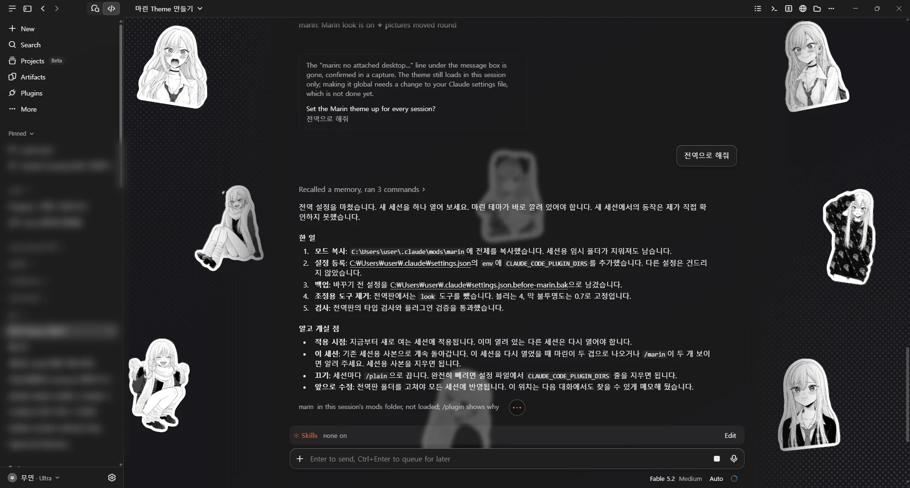

# Marin Theme

A mod for the Code tab of the Claude desktop app that puts eight Kitagawa Marin stickers on the backdrop.



- A dark charcoal ground with manga screentone dots
- Eight stickers with a white edge and a slight tilt, strewn over the whole window
- The chat area is blurred over them, so text stays easy to read
- Dark mode, always

## Install

### Option 1. Clone the folder and register it (Windows)

```powershell
git clone https://github.com/banatic/marin-theme "$HOME\.claude\mods\marin"
```

```powershell
& "$HOME\.claude\mods\marin\install.ps1"
```

`install.ps1` adds this folder to `env.CLAUDE_CODE_PLUGIN_DIRS` in `~/.claude/settings.json`. It keeps the settings as they were in `settings.json.before-marin.bak`. The theme applies to sessions opened after that.

### Option 2. Install as a plugin

At the prompt of a terminal session:

```
/plugin install marin --marketplace banatic/marin-theme
```

From a shell:

```
claude plugin install marin --marketplace banatic/marin-theme
```

In the desktop app, where `/plugin` does not run: click + next to the prompt box, then Plugins, Add marketplace with `banatic/marin-theme`, then Add plugin.

## Use

| Command | What it does |
| --- | --- |
| `/marin` | Puts the theme on, or moves the pictures round one place |
| `/plain` | Takes the theme off for this session |

The pictures also move round one place by themselves every 10 minutes.

## Turn it off

```powershell
& "$HOME\.claude\mods\marin\install.ps1" -Remove
```

## Rebuild the pictures

The stickers are not image files: they are drawn as SVG vector marks. To change their size, number, tilt or edge, edit the values at the top of `assets/build_many.py` and build again.

```powershell
pip install -r assets/requirements.txt
```

```powershell
python assets/build_many.py assets/source assets/pics
```

| Value | Meaning |
| --- | --- |
| `PLACES` | Where each picture sits, as fractions of the window |
| `TILTS` | Each picture's tilt, in degrees |
| `EDGE` | The width of the white sticker edge |
| `LEVELS` | The number of grey tones |

The ground is `assets/pics/ground.svg`.

## What is in the folder

| Path | Contents |
| --- | --- |
| `hooks/register.tsx` | The mod itself |
| `assets/source/` | The eight source pictures |
| `assets/pics/` | The built backdrop layers |
| `assets/*.py` | The scripts that build the layers |
| `install.ps1` | Registers the folder for every session |
| `docs/screenshot.webp` | The screenshot above |

## Why the pictures are drawn as SVG

Claude Desktop (as of 5.11492.5) draws a backdrop from SVG only, and strips every image file embedded in that SVG. So `assets/exact.py` turns each picture's pixels into vector dots and lines, one grey tone at a time. At 100% display scale they come out pixel for pixel.

The whole backdrop has to fit in 262,144 characters, which limits the size of the pictures. Each is about 130-160 × 180-210px.

## Known limits

- Opening the right sidebar covers the stickers behind it. A mod has no way to know where the sidebar is.
- At a display scale other than 100%, the stickers can look slightly soft.
- Once the app draws image backdrops, none of this will be needed.
